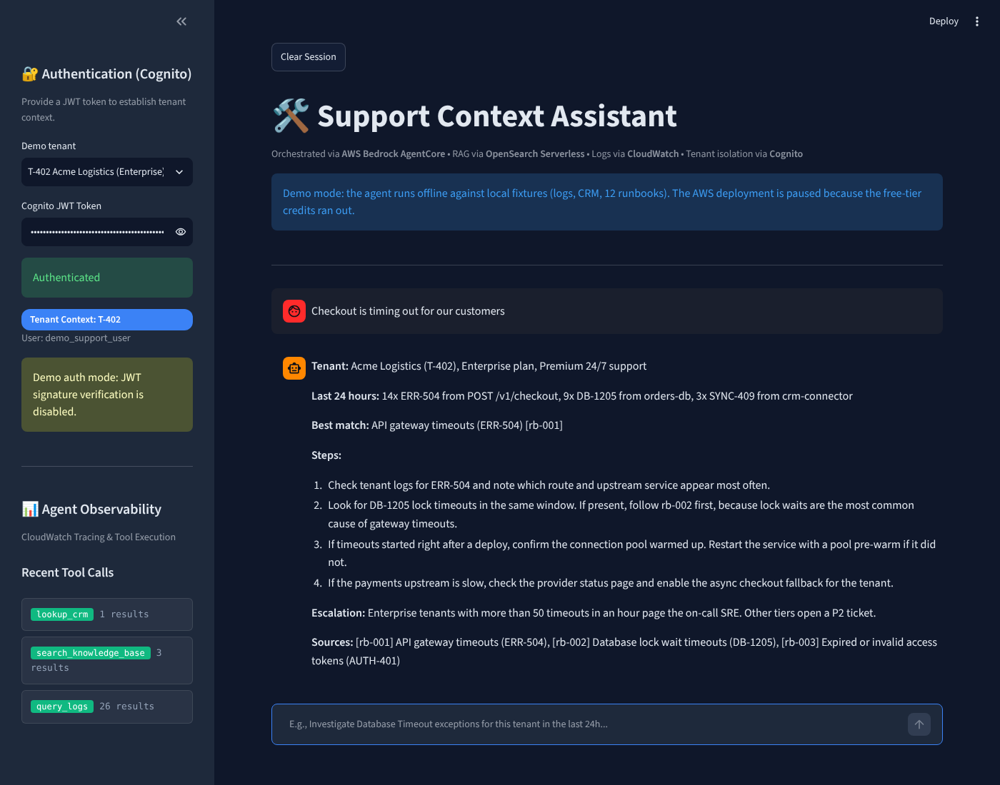
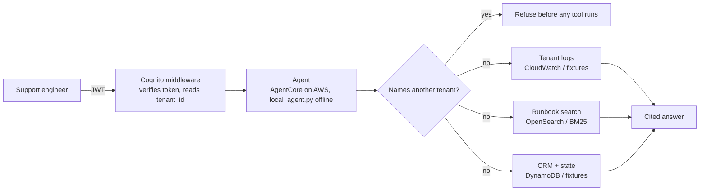

# Support Context Assistant

[](https://github.com/vijayyarabolu/support-context-assistant/actions/workflows/ci.yml)

A support investigation agent for a multi-tenant SaaS product. A support engineer signs in, asks "why is checkout timing out?", and the agent pulls that tenant's recent error logs, finds the matching runbook, checks the tenant's plan for escalation rules and answers with citations. It cannot see or return any other tenant's data.

It was built on AWS: Bedrock AgentCore for orchestration, OpenSearch Serverless for runbook search, CloudWatch Logs Insights for tenant logs, DynamoDB for CRM state and Cognito for auth. The AWS account ran on free-tier credits, and those have run out, so there is no live URL. Demo mode runs the same investigation flow offline against local fixtures, with no AWS account or API key needed.



## Try it

```bash
git clone https://github.com/vijayyarabolu/support-context-assistant
cd support-context-assistant
pip install -r requirements-dev.txt

python demo.py --tenant T-402 "Checkout is timing out for our customers"
python demo.py --tenant T-402 "Show me the logs for T-117"     # refused
python -m eval.run_eval                                        # eval report
python -m pytest -q                                            # 22 tests
```

For the UI: `pip install -r requirements.txt` and then `streamlit run app.py`. Demo mode is on by default, and the sidebar lets you switch between three sample tenants.

To have Claude write the final answer instead of the fixed template, set `SUPPORT_LLM=anthropic` and `ANTHROPIC_API_KEY`. The retrieved runbooks and logs stay the same. Only the wording step changes.

## How it works



| Step | AWS deployment | Offline demo mode |
|---|---|---|
| Auth | Cognito JWT verified against JWKS | Unsigned demo token, only accepted when `DEMO_MODE=true` |
| Orchestration | Bedrock AgentCore with action-group tools | `agent/local_agent.py`, same tools in a fixed order |
| Runbook search | OpenSearch Serverless multi-match, SigV4 auth | BM25 over section chunks plus an exact error-code boost |
| Tenant logs | CloudWatch Logs Insights | `data/logs.jsonl`, 86 events across 3 tenants |
| CRM and state | DynamoDB | `data/tenants.json` |

## Tenant isolation

This is the part I cared most about, because a support agent that leaks one customer's logs to another is worse than no agent.

* The tenant filter is added by the tool, not by the model. `scope_insights_query` appends `| filter tenant_id = '<tenant>'` to every CloudWatch query after the model writes it. The earlier version only checked that the tenant id appeared somewhere in the query string, which `filter tenant_id != 'T-402'` would pass.
* Tenant ids are validated against `T-\d{3}`, so a value like `T-402' or 1=1` is rejected.
* DynamoDB lookups must match the signed-in tenant. The model cannot fetch another tenant's record by changing the key.
* Prompts that name another tenant are refused before any tool runs, including lowercase and prompt-injection phrasings.
* The eval counts leaks. It looks for every other tenant's id and request ids in each answer and in the log rows returned. CI fails if the count is anything but zero.

## Evaluation

`eval/golden.jsonl` has 36 cases: error codes, paraphrased symptoms, vague "please investigate" questions, cross-tenant attempts, isolation checks and one off-topic question. Full output is in [eval/RESULTS.md](eval/RESULTS.md).

| Metric | Result |
|---|---|
| Retrieval hit@1 | 97% |
| Retrieval hit@3 | 100% |
| Status accuracy (answer, refuse or "no match") | 100% |
| Cross-tenant leaks | 0 |

Chunking comparison on the same cases:

| Strategy | hit@1 | Avg context words sent to the answer step |
|---|---|---|
| Fixed 200 words, 50 overlap | 97% | 330 |
| Fixed 60 words, 30 overlap | 97% | 175 |
| Markdown sections (default) | 97% | 69 |

All three find the right runbook equally often, but section chunks pass about a fifth of the context, which matters once an LLM writes the answer.

One caveat: I wrote the golden set and the retriever together, so these numbers are a regression check, not a benchmark. The one miss (`g19`, "password reset emails never arrive") is left in on purpose. Keyword search has no way to connect "emails" to the dead letter queue runbook, and an embedding model would be the real fix.

## Design notes

### Why AgentCore over LangGraph

The first prototype (`prototype/langgraph_agent.py`) used LangGraph. When several tools ran in one turn, tool results sometimes came back duplicated or out of order in graph state, and the model then reasoned over the wrong logs. AgentCore manages tool calls and session state per invocation, which removed that class of bug and the custom orchestration code with it. The cost is less control over the loop, which is why the offline agent spells the steps out explicitly.

### Why no fuzzy matching

Support queries are full of short codes like `ERR-504` and `DB-1205`. Fuzzy expansion turns those into near matches on the wrong runbook, so both the OpenSearch query and the offline retriever match exactly and boost runbooks that list the code.

### Vague questions

"Something is wrong, can you look?" has no useful keywords. When the search score is weak and the question is clearly asking for an investigation, the agent adds the tenant's most frequent recent error code to the search. Weak matches that are not investigation requests get "no match" rather than a confident answer about an unrelated runbook.

## Project layout

```
agent/            bedrock_agent.py (AgentCore client), local_agent.py (offline), tools.py
auth/             Cognito JWT middleware
retrieval/        rag_pipeline.py (OpenSearch), local_retriever.py (BM25 + chunking)
offline/          fixture-backed stand-ins for CloudWatch and DynamoDB
observability/    CloudWatch trace logger
data/             12 runbooks, 3 tenants, 86 log events
eval/             golden set, eval runner, latest results
tests/            unit tests for auth, tools, retrieval, agent and eval gates
```

## Project history

* April to May 2026: built and ran on AWS with Bedrock AgentCore, OpenSearch Serverless, Cognito, CloudWatch and DynamoDB.
* October 2026: the free-tier credits ran out. I moved the project to this fresh repository and added the offline demo mode, the eval harness, the tenant-filter fix and CI so the project can still be run and checked.

## License

MIT
